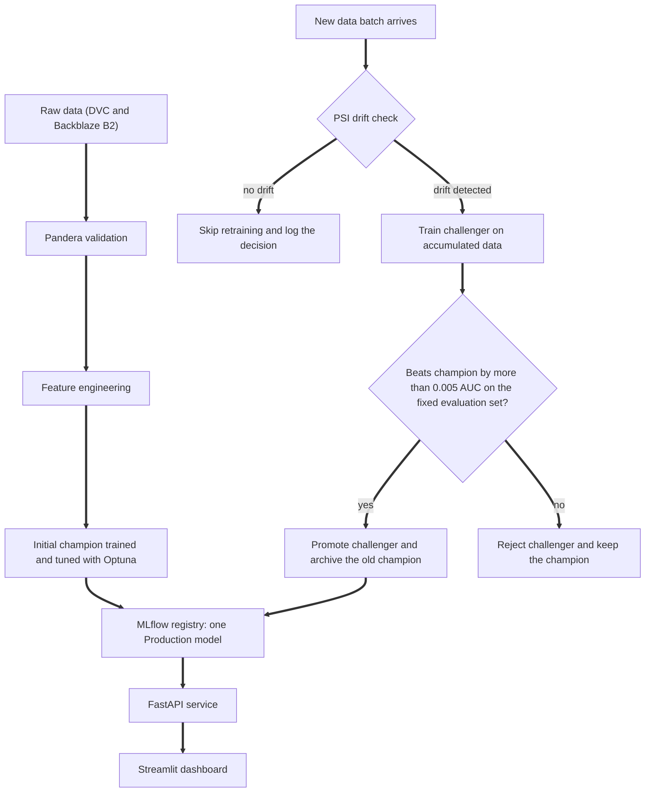

# sMLOps

### A lightweight, automated MLOps pipeline for small teams, built entirely on free tools


A machine learning model is not finished when it is trained. That is the moment its decay begins. Customers change, markets move, data pipelines break quietly, and the model keeps answering with full confidence.

sMLOps is a complete, working lifecycle that looks after a model once it leaves the notebook. It validates the data coming in, notices when that data drifts, retrains only when it has to, promotes a new model only when it has proven itself better, serves the winner through an API, and records every decision along the way. It runs on free and open source tools, on a single laptop, at zero infrastructure cost.

The demo model predicts loan default risk on the Home Credit dataset, but it is deliberately the least important part of this repository. The product is the pipeline around it. Swap the model and the dataset, and the same machinery applies.

## The problems it sets out to solve

Most small teams and student projects stop at "the model works in a notebook". Production exposes a different set of problems:

* **Bad data slips in unnoticed.** A changed column, a flood of missing values, or a unit mix up silently corrupts training.
* **Retraining is manual or blind.** Teams retrain on a calendar whether the data changed or not, wasting compute, or they forget to retrain at all.
* **New models replace old ones without proof.** A retrained model can be worse than the one it replaces, and nobody finds out until users complain.
* **Nobody can say what is running.** Which model is live? What data and parameters produced it? Without a registry, the answer is a guess.
* **The model served is not the model tested.** Preprocessing written twice, once for training and once for the API, drifts apart. This is training serving skew.
* **Enterprise MLOps platforms are out of reach.** Licences, cloud bills, and operational overhead price small teams out of doing this properly.

## What sMLOps offers

* **Data versioning and validation.** The dataset is tracked with DVC and stored on Backblaze B2. A Pandera schema checks key columns and null ratios, and rejects a bad batch before it can reach training.
* **Drift detection that decides.** The Population Stability Index (PSI) is computed for seven key features on every incoming batch. A PSI above 0.2 on any feature triggers retraining. Every check is logged to MLflow with its decision, so skipped rounds leave a trace too.
* **A fair champion and challenger contest.** A challenger is trained on all data accumulated so far and compared with the current champion on a fixed evaluation set that is never trained on. It is promoted only if it beats the champion by more than 0.005 AUC. A rejected challenger changes nothing.
* **A model registry with one source of truth.** MLflow versions every trained model. Exactly one version is in Production, and every earlier champion is archived, never deleted.
* **Orchestration.** The whole loop is a Prefect flow made of retryable tasks. It can run once on demand or as a deployment that fires every Sunday at 02:00 UTC.
* **Serving without skew.** A FastAPI service loads the Production model straight from the registry. Requests are validated with Pydantic, invalid input is refused with a clear error, and a reload endpoint swaps in a newly promoted champion without a restart. If the registry is unreachable, the service falls back to the last saved model file instead of going down.
* **A dashboard for people, not just APIs.** A Streamlit app scores applicants, shows which model is serving and its version history, charts drift per feature and per batch, and lists every promote or reject decision.
* **Explainability.** SHAP plots show which features drive the model globally and for individual applicants.

## How it works



1. **Ingest and validate.** Raw data is versioned with DVC. The Pandera schema must pass before anything is trained.
2. **Train the first champion.** LightGBM with class weighting and Optuna tuned hyperparameters is trained, evaluated on the fixed evaluation set, and registered as Production.
3. **Watch the stream.** Each new batch is compared with the reference distribution using PSI.
4. **Retrain only on evidence.** No drift means no retraining. Drift means a challenger is trained.
5. **Promote on merit.** The challenger faces the champion on the same unseen evaluation set. The registry changes only if it wins by the required margin.
6. **Serve and observe.** The API serves whatever the registry marks as Production, and the dashboard shows the state of the whole system.

## Results from the built in simulation

The Home Credit data has no real time axis, so the pipeline is exercised with a simulated stream: an initial training pool, three incoming batches, and a permanent evaluation set. Batch 2 is deliberately perturbed so the drift gate has something real to catch.

* **Drift detection works both ways.** The drifted batch scored a maximum PSI of 0.568 (on EXT_SOURCE_2), with AMT_INCOME_TOTAL at 0.455. The two clean batches stayed below 0.0004 on every feature.
* **Retraining happened once, not three times.** Two of the three rounds were skipped. Without the gate, every round would have trained a model.
* **The promotion rule held its ground.** The challenger reached 0.7694 AUC against the champion's 0.7653. That gain of 0.0041 falls short of the 0.005 margin, so it was rejected. An improvement that small could be noise, and the pipeline refused to act on it.
* **Serving matches training.** A skew check scored real evaluation rows through the API and compared them with the offline pipeline. The largest difference was 0.000043, which is rounding.
* **The API is fast.** Fifty consecutive requests averaged about 20 ms, with a 95th percentile of about 21 ms on a local machine.
* **The decision bands separate real risk.** On the evaluation set, applicants approved by the API defaulted 3.2% of the time, manual review cases 11.1%, and rejected applicants 28.7%.
* **The registry stays clean.** Across every run, exactly one version is in Production and all earlier ones are archived.

## Tech stack

* **Data versioning:** DVC with a Backblaze B2 remote
* **Validation:** Pandera
* **Experiment tracking and model registry:** MLflow
* **Orchestration:** Prefect
* **Hyperparameter tuning:** Optuna
* **Drift detection:** custom PSI implementation
* **Model:** LightGBM
* **Serving:** FastAPI with Pydantic validation
* **Dashboard:** Streamlit
* **Explainability:** SHAP
* **Language:** Python 3.11

## Repository layout

```
sMLOps/
├── app.py                    Streamlit dashboard
├── requirements.txt
├── data/                     Raw data tracked by DVC, simulated batches generated locally
├── models/                   Champion model, its feature columns, and tuned parameters
├── reports/shap/             SHAP plots and the feature importance table
└── src/
    ├── simulate_batches.py   Builds the initial pool, three batches, and the evaluation set
    ├── validate.py           Pandera schema checks
    ├── preprocessing.py      Cleaning and feature engineering
    ├── train.py              Model building, MLflow logging, registry promotion, promote or reject rule
    ├── detect_drift.py       PSI drift detection
    ├── retrain_pipeline.py   The Prefect flow that ties everything together
    ├── serving.py            Serving time preprocessing, model loading, decision bands
    ├── api.py                FastAPI service
    ├── explain.py            SHAP analysis
    ├── check_serving_skew.py Proves the API matches the offline pipeline
    └── check_latency.py      Measures API response time
```

## Getting started

1. Clone the repository, move into its folder, and create a virtual environment:

   ```
   python3.11 -m venv venv
   source venv/bin/activate
   ```

2. Install everything listed in `requirements.txt` with pip. The file already keeps SQLAlchemy below version 2.1, because Prefect's scheduler currently breaks on 2.1.

3. Get the data. Download the Home Credit Default Risk dataset from Kaggle and place `application_train.csv` in the `data` folder. If you have access to the configured DVC remote, run `dvc pull` instead.

4. Build the simulated data stream:

   ```
   python src/simulate_batches.py
   ```

5. Run the full retraining loop once:

   ```
   python src/retrain_pipeline.py
   ```

6. Inspect the experiments, drift runs, and registry:

   ```
   mlflow ui
   ```

Run every command from the project root, so that MLflow, the API, and the dashboard all use the same tracking store.

## Running the whole system

**API.** Start the service, then open http://127.0.0.1:8000/docs for an interactive page:

```
PYTHONPATH=src python -m uvicorn api:app
```

**Dashboard.** With the API running, start the Streamlit app in a second terminal:

```
streamlit run app.py
```

**Scheduled retraining.** Start the Prefect server in one terminal:

```
prefect server start
```

In a second terminal, point Prefect at it and register the weekly deployment by launching `src/retrain_pipeline.py` with its serve flag (see the entry point at the bottom of that file):

```
prefect config set PREFECT_API_URL=http://127.0.0.1:4200/api
```

You can then trigger runs from the Prefect UI at http://127.0.0.1:4200, and watch the models appear in MLflow.

**Quality checks.** With the API running:

```
python src/check_serving_skew.py
python src/check_latency.py
```

**Explainability.** Regenerate the SHAP plots for the current champion:

```
python src/explain.py
```

## Using the API

The service exposes four endpoints:

* `GET /health` reports whether the service is up and a model is loaded.
* `GET /model-info` reports the model name, the version being served, and the decision bands.
* `POST /predict` scores one applicant and returns a risk score, a decision, and the model version.
* `POST /reload` loads the newest Production model without restarting the service.

A minimal call from Python:

```python
import requests

payload = {
    "amt_income_total": 150000,
    "amt_credit": 500000,
    "age_years": 35,
    "years_employed": 5,
    "name_contract_type": "Cash loans",
    "code_gender": "F",
    "flag_own_car": "N",
    "flag_own_realty": "Y",
    "name_income_type": "Working",
    "name_education_type": "Higher education",
    "name_family_status": "Married",
    "name_housing_type": "House / apartment",
}

response = requests.post("http://127.0.0.1:8000/predict", json=payload)
print(response.json())
```

The response contains `default_probability` (the risk score), `decision` (approve, manual_review, or reject), and `model_version`. Optional fields such as the three external risk scores can simply be left out and are treated as missing. Invalid input, such as an age below 18 or an unknown category, is refused with an HTTP 422 response that names the problem.

## Design decisions worth knowing

* **A fixed evaluation set keeps the contest honest.** It is carved out first and never trained on, so every champion and challenger is judged on identical ground.
* **The promotion margin is a business rule.** The 0.005 AUC threshold is a single constant, easy to tighten or relax.
* **Serving preprocessing is built by hand.** One hot encoding a single applicant with the usual library call would silently misencode every row, so the API aligns each request to the exact columns the champion was trained on, and the skew check proves it.
* **Scores are risk scores, not probabilities.** The model uses class weighting, which ranks applicants well but inflates raw scores. The decision bands were validated against actual default rates instead of being trusted blindly.
* **Drift in the demo is injected on purpose.** Real data would drift on its own. The simulation guarantees a detectable signal so the whole loop can be demonstrated end to end.

## Limitations and roadmap

Planned next steps:

* A pytest suite covering the promotion rule, drift detection, validation, and serving logic
* An Evidently report alongside the custom PSI check
* Docker packaging, CI on GitHub Actions, and a hosted demo
* Slack alerts for retraining and promotion events
* Score calibration, so risk scores can be read as true probabilities
* Moving the registry from stages to MLflow aliases
* Live SHAP explanations inside the dashboard

## About

sMLOps is a final year project by Om Parab, built to show that production grade MLOps is within reach of individuals and small teams without paid infrastructure. See the LICENSE file for licence terms.
